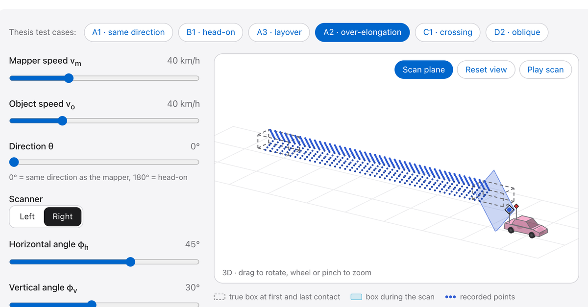

# Motion-Induced Point Cloud Distortions in Mobile Laser Scanning

When a mobile laser scanner and the object it scans are both moving, the point cloud is distorted: the object can look shorter, longer, reversed (**layover**) or skewed into a **parallelepiped**. This project gives closed-form equations for these distortions and an interactive simulator to explore them.

**Project page and simulator: https://amanks-20.github.io/mls-distortions/**

[](https://amanks-20.github.io/mls-distortions/static/video/explorer-demo.mp4)

*Click the image for a 30 s demo video (no sound).*

## Publications

- **Journal article** (★ Editor's Choice): Singh, A. K., & Lohani, B. (2026). Modeling Point Cloud Distortions in Mobile Laser Scanning for Surveying. *Journal of Surveying Engineering*, 152(3), 04026006. https://doi.org/10.1061/JSUED2.SUENG-1663
- **Thesis:** Singh, A. K. (2025). *Understanding and Modeling Motion-Induced Point Cloud Distortions in Mobile Laser Scanning.* B.Tech–M.Tech (Dual Degree) Thesis, IIT Kanpur. https://doi.org/10.6084/m9.figshare.32005947
- **Defense slides:** https://doi.org/10.5281/zenodo.23734352
- **Posters:** GeodCon-26, INSA New Delhi, 2026 (https://doi.org/10.6084/m9.figshare.32005995) · Geospatial Technologies and Smart Cities Workshop, IIT Kanpur & University of Melbourne, 2025 (https://doi.org/10.6084/m9.figshare.28200089)

## Using the simulator

Choose a thesis test case or set the speeds, direction and scan angles yourself. The readouts come from the paper's equations; a separate scan simulation draws the point cloud, in a 2D top view or in 3D. The 3D view is not used for the readouts, and its scanner height (2.5 m), mounting position and car shape are illustrative, not from the thesis.

For A2 and B1, a panel shows a vehicle from a real StreetMapper survey in Guwahati in the same regime. Its speeds are estimates from the point clouds, and the survey data are not public.

## Running it locally

The page is static HTML, CSS and JavaScript with no build step: open `index.html`, or serve the repository root (GitHub Pages serves `main`).

```
index.html     the page
static/js/     explorer.js (equations + 2D simulation), simulate3d.js and view3d.js (3D), field-*.js (field panel)
static/css/    styles
static/images/ figures and field images
static/video/  demo video
tests/         checks (dev only)
tools/         scripts that render the field images (dev only; need the survey data)
```

Checks need Python 3 and Node.js (or macOS JavaScriptCore):

```
python3 tests/check.py           # 2D model and simulation against tests/golden.json
python3 tests/check3d.py         # 3D scan against the 2D model
python3 tests/check3d_angles.py  # 3D angles against the equations
```

## Citation

Please cite the paper. Metadata is in [`CITATION.cff`](CITATION.cff) (GitHub's "Cite this repository" button).

```bibtex
@article{singh2026modeling,
  title   = {Modeling Point Cloud Distortions in Mobile Laser Scanning for Surveying},
  author  = {Singh, Aman Kumar and Lohani, Bharat},
  journal = {Journal of Surveying Engineering},
  volume  = {152},
  number  = {3},
  pages   = {04026006},
  year    = {2026},
  doi     = {10.1061/JSUED2.SUENG-1663}
}
```

DOI: to be added after the first archived release

## Licence

The code (`static/js/`, `static/css/`, `index.html`, `tests/`, `tools/`) is under the [MIT Licence](LICENSE). The figures from the paper and thesis, the field images, the demo video and the written text are not, and remain with their owners.

## Author

[Aman Kumar Singh](https://amanks-20.github.io/), IIT Kanpur, supervised by [Prof. Bharat Lohani](https://home.iitk.ac.in/~blohani/). Developed with coding assistance from Claude (Anthropic).
